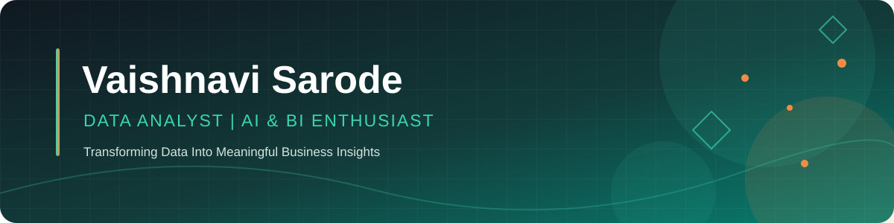

<!-- ===================================================== -->
<!--              VAISHNAVI SARODE - PROFILE              -->
<!-- ===================================================== -->

<!-- Custom Profile Banner -->

<!-- Animated Typing Text -->

 

---

---

## ✨ About Me

Hi! I'm **Vaishnavi Sarode**, an Artificial Intelligence & Data Science graduate passionate about Data Analytics, Business Intelligence, and Artificial Intelligence.

I enjoy exploring data, identifying meaningful patterns, and transforming complex datasets into actionable business insights.

- 🎓 B.E. in Artificial Intelligence & Data Science (2025)
- 📊 Interested in Data Analytics & Business Intelligence
- 💻 Working with Python, SQL, Power BI & Excel
- 🧠 Exploring Machine Learning and Generative AI
- 📚 Published research on Zero-Shot Learning with LLMs
- 🚀 Passionate about solving real-world business problems
- 🌱 Always learning, building, and improving

 

## 📊 My Tech Stack

### 💻 Programming & Query Languages

### 📈 Data Analytics & Visualization

---

### Development & Other Tools

---

## 🚀 Featured Projects

<table>
<tr>
<td width="50%">

### 📊 Myntra Sales & Customer Analytics

**Power BI | Data Analytics**

- Interactive sales and customer dashboard.
- KPI tracking and business performance analysis.
- Visual exploration of order and customer data.

</td>
<td width="50%">

### 📉 Customer Churn & Retention Analytics

**BigQuery | SQL | Python**

- Customer churn analysis.
- Data validation and cleaning.
- Identification of customer retention patterns.

</td>
</tr>
<tr>
<td width="50%">

### 🛒 E-Commerce Sales Analysis

**MySQL | SQL**

- Business-focused sales analysis.
- Joins, CTEs, subqueries and window functions.
- Customer lifetime value analysis.

</td>
<td width="50%">

### 💰 Loan Risk Prediction

**Python | Machine Learning**

- Loan risk analysis.
- Data preprocessing and exploratory analysis.
- Predictive modeling.

</td>
</tr>
</table>

> Explore my repositories for project documentation, analysis, and implementation details.

---

## 📚 Research & Publication

### Q&A in Financial Queries Using Zero-Shot Learning with LLM for Novel Task Understanding

**Journal:** Journal of Information Systems Engineering and Management (2025)

Explored the application of Zero-Shot Learning with Large Language Models to understand and answer novel financial queries without task-specific training examples.

---

## 📈 GitHub Statistics

<!-- GitHub Profile Stats -->

<!-- Most Used Programming Languages -->

---

## 🎯 Current Focus

- Strengthening advanced SQL and analytical thinking.
- Building interactive Power BI dashboards.
- Improving Python for data analysis.
- Exploring AI and machine learning applications.
- Developing business-oriented analytical projects.

---

## 🤝 Let's Connect

  

**💡 Turning curiosity into insights and insights into impact.**

